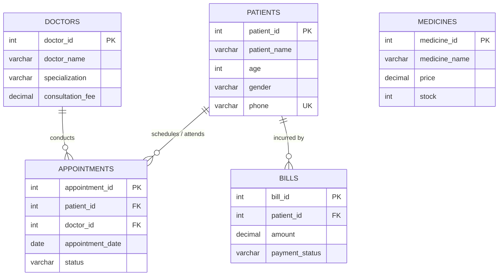

# LifeBridge Pro — Hospital Management Database System

[](https://www.mysql.com/)
[](#database-normalization)
[](#data-integrity--constraints)
[](LICENSE)

**LifeBridge Pro** is a normalized relational database management system (RDBMS) engineered for healthcare and clinical environments. It tracks patient demographics, medical staff directories, clinical appointments, pharmacy medicine inventory, and invoicing while enforcing referential integrity and performance indexing.

---

## Table of Contents

- [Overview](#overview)
- [Key Features](#key-features)
- [Entity-Relationship (ER) Diagram](#entity-relationship-er-diagram)
- [Schema Architecture](#schema-architecture)
- [Data Integrity & Constraints](#data-integrity--constraints)
- [Database Normalization](#database-normalization)
- [Performance & Indexing](#performance--indexing)
- [Analytical Queries & Reporting](#analytical-queries--reporting)
- [Getting Started](#getting-started)
  - [Prerequisites](#prerequisites)
  - [Installation & Setup](#installation--setup)
- [Project Structure](#project-structure)
- [Future Enhancements](#future-enhancements)
- [License](#license)

---

## Overview

Modern healthcare facilities handle interconnected workflows ranging from patient intake to doctor consultations, pharmacy fulfillment, and revenue cycle management. 

**LifeBridge Pro** models these operational workflows into a relational schema that:
- Prevents data anomalies using primary, foreign key, domain `CHECK`, and `UNIQUE` constraints.
- Employs B+ tree indexing on critical search predicates (`patient_name`, `appointment_date`).
- Provides business reporting via complex multi-table joins, scalar subqueries, and aggregation routines.

---

## Key Features

- **Patient Lifecycle Management**: Comprehensive intake storage with non-negative age validation and unique phone contact enforcement.
- **Doctor Directory**: Medical practitioners categorized by clinical specialization with standardized consultation fees.
- **Appointment Scheduling**: Relational mapping between patients and doctors with real-time status tracking (`Scheduled`, `Completed`, `Cancelled`).
- **Pharmacy & Inventory Control**: Medicine catalog with real-time stock counting and unit pricing constraints.
- **Billing & Invoicing**: Patient billing ledger with automated payment tracking (`Paid`, `Pending`).
- **Data Validation & Negative Testing**: Pre-configured test cases validating that invalid data (negative age, orphaned billing records) are rejected by the engine.

---

## Entity-Relationship (ER) Diagram



---

## Schema Architecture

### 1. `Patients`
Stores patient registration records.
```sql
CREATE TABLE Patients (
    patient_id INT PRIMARY KEY AUTO_INCREMENT,
    patient_name VARCHAR(100) NOT NULL,
    age INT CHECK (age >= 0),
    gender VARCHAR(10),
    phone VARCHAR(15) UNIQUE
);
```

### 2. `Doctors`
Stores medical practitioners and their consultation tariffs.
```sql
CREATE TABLE Doctors (
    doctor_id INT PRIMARY KEY AUTO_INCREMENT,
    doctor_name VARCHAR(100) NOT NULL,
    specialization VARCHAR(100) NOT NULL,
    consultation_fee DECIMAL(10,2) NOT NULL CHECK (consultation_fee >= 0)
);
```

### 3. `Appointments`
Manages scheduled clinical sessions linking patients to assigned physicians.
```sql
CREATE TABLE Appointments (
    appointment_id INT PRIMARY KEY AUTO_INCREMENT,
    patient_id INT NOT NULL,
    doctor_id INT NOT NULL,
    appointment_date DATE NOT NULL,
    status VARCHAR(20) DEFAULT 'Scheduled',
    FOREIGN KEY (patient_id) REFERENCES Patients(patient_id),
    FOREIGN KEY (doctor_id) REFERENCES Doctors(doctor_id)
);
```

### 4. `Medicines`
Manages pharmaceutical stock and unit prices.
```sql
CREATE TABLE Medicines (
    medicine_id INT PRIMARY KEY AUTO_INCREMENT,
    medicine_name VARCHAR(100) NOT NULL,
    price DECIMAL(10,2) NOT NULL CHECK (price >= 0),
    stock INT NOT NULL DEFAULT 0 CHECK (stock >= 0)
);
```

### 5. `Bills`
Tracks patient billing and payments.
```sql
CREATE TABLE Bills (
    bill_id INT PRIMARY KEY AUTO_INCREMENT,
    patient_id INT NOT NULL,
    amount DECIMAL(10,2) NOT NULL CHECK (amount >= 0),
    payment_status VARCHAR(20) DEFAULT 'Pending',
    FOREIGN KEY (patient_id) REFERENCES Patients(patient_id)
);
```

---

## Data Integrity & Constraints

The database implements multi-layered validation logic at the storage engine level:

| Constraint Type | Target Table / Column | Purpose |
| :--- | :--- | :--- |
| **Primary Key** | All tables (`*_id`) | Guarantees entity integrity and clustered index ordering. |
| **Foreign Key** | `Appointments`, `Bills` | Enforces referential integrity; prevents orphaned records. |
| **Unique Key** | `Patients(phone)` | Prevents duplicate patient registrations. |
| **Domain Checks** | `age >= 0`, `price >= 0`, `stock >= 0`, `consultation_fee >= 0`, `amount >= 0` | Rejects nonsensical negative numbers at write time. |
| **Defaults** | `status = 'Scheduled'`, `payment_status = 'Pending'`, `stock = 0` | Standardizes initial transaction state without requiring manual input. |

---

## Database Normalization

The schema complies with **Third Normal Form (3NF)** standards:

- **First Normal Form (1NF)**: Every table has an explicit primary key, all columns hold atomic (indivisible) scalar values, and there are no repeating groups.
- **Second Normal Form (2NF)**: The database is in 1NF and contains no partial dependencies. Because all tables utilize single-column surrogate primary keys (`AUTO_INCREMENT`), every non-key attribute depends entirely on the whole key.
- **Third Normal Form (3NF)**: The database is in 2NF and contains no transitive dependencies ($X \to Y \to Z$). Non-key attributes (such as doctor fees, appointment statuses, and medicine prices) depend directly on their primary identifier and nothing else.

---

## Performance & Indexing

To optimize query latency across scaling datasets, secondary B+ Tree indexes are established on high-cardinality search columns:

```sql
-- Speeds up patient searches by name and alphabetical sorting
CREATE INDEX idx_patient_name ON Patients(patient_name);

-- Accelerates date-range filtering and calendar schedule views
CREATE INDEX idx_appointment_date ON Appointments(appointment_date);
```

### Performance Impact:
- **Search Complexity**: Reduces search operations on indexed columns from a full table scan ($\mathcal{O}(N)$) to a logarithmic B+ tree traversal ($\mathcal{O}(\log N)$).
- **Execution Plan**: Range queries like `WHERE appointment_date BETWEEN '2026-11-01' AND '2026-11-07'` utilize index range scans instead of reading all table pages.

---

## Analytical Queries & Reporting

The database script includes pre-built analytical queries modeling hospital business intelligence:

### 1. Unified Appointment Schedule (3-Table Inner Join)
```sql
SELECT
    A.appointment_id,
    P.patient_name,
    D.doctor_name,
    D.specialization,
    A.appointment_date,
    A.status
FROM Appointments A
JOIN Patients P ON A.patient_id = P.patient_id
JOIN Doctors D ON A.doctor_id = D.doctor_id;
```

### 2. Doctors Charging Above-Average Consultation Fees (Scalar Subquery)
```sql
SELECT *
FROM Doctors
WHERE consultation_fee > (
    SELECT AVG(consultation_fee)
    FROM Doctors
);
```

### 3. High-Value Patients with Bills Above Hospital Average (Nested Subquery)
```sql
SELECT patient_name
FROM Patients
WHERE patient_id IN (
    SELECT patient_id
    FROM Bills
    WHERE amount > (
        SELECT AVG(amount) FROM Bills
    )
);
```

### 4. Pending Revenue Report (Unpaid Balances)
```sql
SELECT * FROM Bills
WHERE payment_status <> 'Paid';
```

### 5. Critical Pharmacy Inventory Alert
```sql
SELECT * FROM Medicines 
WHERE stock < 30;
```

---

## Getting Started

### Prerequisites
- [MySQL Server 8.0+](https://dev.mysql.com/downloads/mysql/) (or MariaDB 10.5+)
- [MySQL Workbench](https://dev.mysql.com/downloads/workbench/), [DBeaver](https://dbeaver.io/), or command-line client

### Installation & Setup

1. **Clone the Repository**:
   ```bash
   git clone https://github.com/justmakeitup/LifeBridgePro.git
   cd LifeBridgePro
   ```

2. **Execute Database Setup via MySQL CLI**:
   ```bash
   mysql -u root -p < Lifebridgepro.sql
   ```

3. **Verify the Installation**:
   ```sql
   USE LifeBridgePro;
   SHOW TABLES;
   ```

---

## Project Structure

```text
lifebridge-pro/
├── Lifebridgepro.sql            # Master DDL/DML script (schema, seed data, indexes, analytics)
├── LifeBridgePro SQL Deck.pptx  # Project presentation deck for viva/walkthroughs
└── README.md                    # Detailed documentation and architecture guide
```

---

## Future Enhancements

- **Prescription Junction Entity**: Link `Appointments` and `Medicines` via a `Prescriptions(prescription_id, appointment_id, medicine_id, dosage)` table.
- **Itemized Billing**: Decompose `Bills` into a header-line structure (`Bill_Headers` and `Bill_Items`) to reflect consultation fees, diagnostic tests, and dispensed medications.
- **Audit Logging**: Add automated triggers for tracking status changes (`payment_status`, `appointment_status`) with timestamps.

---

## License

This project is open-source and distributed under the [MIT License](LICENSE).
